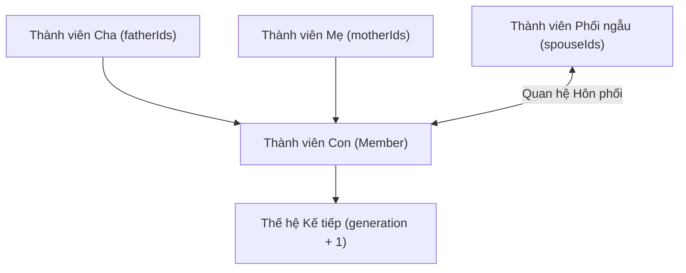
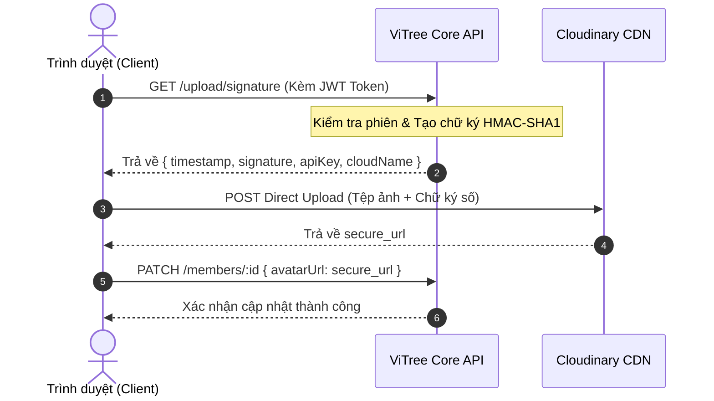

<div align="center">

  <h1>ViTree - Core API &amp; Genealogy Graph Engine</h1>
  <h3>Hệ Thống Backend Quản Trị Cấu Trúc Phả Đồ, Cấp Bậc Huyết Thống &amp; Dịch Vụ Gia Phả Số</h3>

  <p>
    Nền tảng xử lý nghiệp vụ trung tâm và mô hình hóa dữ liệu phả hệ đa thế hệ, cung cấp kiến trúc RESTful API 
    hiệu năng cao trên nền tảng NestJS, quản lý đồ thị quan hệ huyết thống và hôn phối hai chiều, 
    bộ động cơ đồng bộ ngày kỵ nhật âm lịch, cơ chế cấp chữ ký tải ảnh Cloudinary an toàn không lộ khóa bí mật 
    và hệ thống bảo mật phân tầng đạt chuẩn an ninh cao nhất.
  </p>

  <p>
    
    
    
    
    
    
    
    
  </p>

</div>

<br />

# BACKEND API SERVICE &amp; GENEALOGY GRAPH ENGINE

Đây là kho lưu trữ chứa mã nguồn **Backend Core Engine** của hệ thống **ViTree** — Nền tảng Quản trị Gia phả Trực quan và Số hóa Cội nguồn Dòng tộc. Hệ thống được thiết kế theo kiến trúc module hóa chặt chẽ của **NestJS**, kết hợp cơ sở dữ liệu **MongoDB** (thông qua Mongoose ODM) nhằm xử lý linh hoạt cấu trúc cây phả hệ phức tạp, các nhánh con cháu phân cấp sâu và quan hệ hôn phối đa chiều.

Dự án đã được rà soát an ninh toàn diện và vá triệt để tất cả các lỗ hổng bảo mật nghiêm trọng (Lỗ hổng DoS trong Multer `CVE-2026-113872`, lỗ hổng DoS/ReDoS trong Path-to-RegExp `GHSA-j3q9-mxjg-w52f`, và lỗ hổng tiêu thụ CPU bất thường trong JS-YAML `CVE-2026-59870`). Toàn bộ dependencies được nâng cấp đồng bộ, kiểm định qua `npm audit` với kết quả **0 lỗ hổng bảo mật**.

---

## Mục lục

- [1. Công nghệ &amp; Thư viện Cốt lõi](#1-công-nghệ--thư-viện-cốt-lõi)
  - [Khung Ứng dụng &amp; Máy chủ Nền tảng](#khung-ứng-dụng--máy-chủ-nền-tảng)
  - [Cơ sở Dữ liệu &amp; Quản lý Mô hình Thực thể](#cơ-sở-dữ-liệu--quản-lý-mô-hình-thực-thể)
  - [Xác thực, Phân quyền &amp; Bảo mật API](#xác-thực-phân-quyền--bảo-mật-api)
  - [Xử lý Đa phương tiện, Tài liệu &amp; Tiện ích Mở rộng](#xử-lý-đa-phương-tiện-tài-liệu--tiện-ích-mở-rộng)
- [2. Kiến trúc Nghiệp vụ &amp; Cấu trúc Dữ liệu Phả hệ](#2-kiến-trúc-nghiệp-vụ--cấu-trúc-dữ-liệu-phả-hệ)
  - [2.1. Mô hình Đồ thị Huyết thống Đa chiều (Multi-parental &amp; Marriage Graph)](#21-mô-hình-đồ-thị-huyết-thống-đa-chiều-multi-parental--marriage-graph)
  - [2.2. Quản lý Thế hệ, Thứ bậc &amp; Định danh Danh xưng](#22-quản-lý-thế-hệ-thứ-bậc--định-danh-danh-xưng)
  - [2.3. Động cơ Lịch Âm &amp; Quản lý Ngày giỗ (Lunar Death Anniversary Engine)](#23-động-cơ-lịch-âm--quản-lý-ngày-giỗ-lunar-death-anniversary-engine)
  - [2.4. Cơ chế Cấp Chữ ký Số Upload Trực tiếp (Direct-to-Cloudinary Signature Flow)](#24-cơ-chế-cấp-chữ-ký-số-upload-trực-tiếp-direct-to-cloudinary-signature-flow)
  - [2.5. Bảo mật Phân tầng, Giới hạn Tần suất &amp; Xác thực JWT](#25-bảo-mật-phân-tầng-giới-hạn-tần-suất--xác-thực-jwt)
  - [2.6. Khắc phục Triệt để Các Lỗ hổng Bảo mật Trọng yếu (Security Hardening)](#26-khắc-phục-triệt-để-các-lỗ-hổng-bảo-mật-trọng-yếu-security-hardening)
- [3. Danh mục API Endpoints (Swagger OpenAPI 3.0)](#3-danh-mục-api-endpoints-swagger-openapi-30)
- [4. Hướng dẫn Cài đặt &amp; Khởi chạy](#4-hướng-dẫn-cài-đặt--khởi-chạy)
- [5. Cấu trúc Thư mục Dự án](#5-cấu-trúc-thư-mục-dự-án)
- [6. Tích hợp Hệ sinh thái](#6-tích-hợp-hệ-sinh-thái)
- [7. Tác giả](#7-tác-giả)

---

## 1. Công nghệ &amp; Thư viện Cốt lõi

Hệ thống được phát triển trên nền tảng **Node.js** và **TypeScript** hiện đại, áp dụng mô hình kiến trúc Dependency Injection hướng đối tượng của NestJS:

### Khung Ứng dụng &amp; Máy chủ Nền tảng

| Công nghệ / Thư viện | Phiên bản | Vai trò Kỹ thuật |
| :--- | :--- | :--- |
| **[NestJS Core](https://nestjs.com/)** | `^11.2.8` | Khung ứng dụng máy chủ hướng module, hỗ trợ kiến trúc phân tầng vững chắc |
| **[NestJS Common](https://nestjs.com/)** | `^11.2.8` | Bộ công cụ trang trí (Decorators), Pipes, Interceptors và Middleware cốt lõi |
| **[NestJS Platform Express](https://nestjs.com/)** | `^11.2.8` | Tầng chuyển tiếp HTTP Adapter dựa trên Express Engine |
| **[NestJS Config](https://docs.nestjs.com/techniques/configuration)** | `^4.0.4` | Quản lý biến môi trường tập trung hỗ trợ đa tệp `.env.local` và `.env` |
| **[RxJS](https://rxjs.dev/)** | `^7.8.2` | Xử lý luồng dữ liệu phản ứng và bất đồng bộ |

---

### Cơ sở Dữ liệu &amp; Quản lý Mô hình Thực thể

| Công nghệ / Thư viện | Phiên bản | Vai trò Kỹ thuật |
| :--- | :--- | :--- |
| **[MongoDB](https://www.mongodb.com/)** | `6.0+` | Hệ quản trị cơ sở dữ liệu NoSQL linh hoạt, tối ưu cho cấu trúc phân cấp |
| **[Mongoose](https://mongoosejs.com/)** | `^9.11.4` | Thư viện ODM ánh xạ đối tượng dữ liệu với khả năng populate quan hệ phả hệ |
| **[@nestjs/mongoose](https://github.com/nestjs/mongoose)** | `^11.0.4` | Tích hợp Mongoose vào vòng đời Dependency Injection của NestJS |

---

### Xác thực, Phân quyền &amp; Bảo mật API

| Công nghệ / Thư viện | Phiên bản | Vai trò Kỹ thuật |
| :--- | :--- | :--- |
| **[@nestjs/passport &amp; Passport](http://www.passportjs.org/)** | `^11.0.5 / ^0.7.0` | Khung xác thực đa chiến lược tích hợp bảo vệ các tuyến endpoint nhạy cảm |
| **[@nestjs/jwt &amp; Passport-JWT](https://jwt.io/)** | `^11.0.2 / ^4.0.1` | Cấp phát và giải mã mã thông báo bảo mật JWT Access Token |
| **[Bcrypt](https://github.com/kelektiv/node.bcrypt.js)** | `^6.0.0` | Băm mật khẩu người dùng bằng giải pháp muối hóa (Salt Hashing) an toàn một chiều |
| **[@nestjs/throttler](https://github.com/nestjs/throttler)** | `^6.7.1` | Giới hạn tần suất truy vấn (Rate Limiting: 100 requests / phút), chống tấn công DDoS |

---

### Xử lý Đa phương tiện, Tài liệu &amp; Tiện ích Mở rộng

| Công nghệ / Thư viện | Phiên bản | Vai trò Kỹ thuật |
| :--- | :--- | :--- |
| **[@nestjs/swagger](https://docs.nestjs.com/openapi/introduction)** | `^11.4.7` | Tự động sinh tài liệu Swagger OpenAPI 3.0 trực quan tương tác tại `/api/docs` |
| **[Cloudinary SDK](https://cloudinary.com/)** | `^2.11.0` | Tích hợp dịch vụ quản lý và phân phối ảnh chân dung đại diện trên đám mây |
| **[class-validator &amp; class-transformer](https://github.com/typestack/class-validator)** | `^0.15.1 / ^0.5.1` | Rà soát và chuẩn hóa tự động kiểu dữ liệu DTO đầu vào với Global ValidationPipe |
| **[Multer (Patched)](https://github.com/expressjs/multer)** | `^2.5.0` | Bản vá triệt để lỗ hổng DoS Stream Tear-down `CVE-2026-113872` |
| **[Path-to-RegExp (Patched)](https://github.com/pillarjs/path-to-regexp)** | `^8.4.2` | Bản vá triệt để lỗ hổng ReDoS / DoS `GHSA-j3q9-mxjg-w52f` |
| **[JS-YAML (Patched)](https://github.com/nodeca/js-yaml)** | `^5.5.0` | Bản vá triệt để lỗ hổng Quadratic CPU Consumption `CVE-2026-59870` |

---

## 2. Kiến trúc Nghiệp vụ &amp; Cấu trúc Dữ liệu Phả hệ

### 2.1. Mô hình Đồ thị Huyết thống Đa chiều (Multi-parental &amp; Marriage Graph)

Để phản ánh chính xác các mối quan hệ truyền thống trong gia tộc Việt Nam, thực thể `Member` không bị giới hạn trong cây nhị phân thông thường mà được thiết kế theo cấu trúc đồ thị đa hướng:



* **Quan hệ Trực hệ Phụ Mẫu (`fatherIds`, `motherIds`):** Lưu trữ danh sách `Types.ObjectId` tham chiếu đến các bậc sinh thành, cho phép mô hình hóa các trường hợp đặc biệt như nhiều mẹ (chính thất, kế thất, trắc thất).
* **Quan hệ Hôn phối (`spouseIds`):** Thiết lập liên kết phối ngẫu hai chiều giữa các thành viên. Khi tạo lập hoặc cập nhật quan hệ vợ/chồng, hệ thống tự động kiểm tra tính hợp lệ của ID đối tác và đồng bộ liên kết tương hỗ.
* **Đồng bộ Toàn vẹn Dữ liệu Khi Xóa:** Khi một thành viên bị xóa (`DELETE /members/:id`), hệ thống tự động rà soát cơ sở dữ liệu để loại bỏ ID của người đó khỏi các danh sách `fatherIds`, `motherIds` và `spouseIds` của các thành viên liên đới, bảo đảm tính toàn vẹn tuyệt đối cho đồ thị phả hệ.

---

### 2.2. Quản lý Thế hệ, Thứ bậc &amp; Định danh Danh xưng

Mỗi thành viên trong dòng họ được chuẩn hóa thông tin với các trường dữ liệu phong phú:
* **`fullName` &amp; `tuName`:** Lưu giữ song song họ tên thường dùng và tên tự (hoặc biệt hiệu, thụy hiệu, tên hiệu khi quy tiên).
* **`gender` (`MALE`, `FEMALE`, `UNKNOWN`):** Nhận diện giới tính hỗ trợ tự động vẽ các đường nối huyết thống và phân biệt quy cách xưng hô truyền thống.
* **`status` (`ALIVE`, `DECEASED`, `UNKNOWN`):** Quản lý trạng thái sinh/mất để hiển thị màu sắc biểu trưng và kích hoạt các trường dữ liệu kỵ nhật.
* **`generation` (Đời thứ):** Số nguyên định danh thế hệ trong dòng tộc ($1, 2, 3, \dots$), đánh chỉ mục (`MemberSchema.index({ generation: 1 })`) nhằm tối ưu tốc độ lọc và phân bổ dải thế hệ.
* **`orderInFamily` (Thứ bậc):** Xác định thứ tự ra đời trong gia đình (con trưởng, con thứ hai, con thứ ba, con út...), đánh chỉ mục kết hợp (`fatherIds: 1, orderInFamily: 1`) phục vụ việc sắp xếp thứ tự hiển thị chính xác từ trái qua phải.
* **`isHeirless`:** Đánh dấu thành viên vô tự nhằm ghi nhận trung thực lịch sử phát triển dòng họ.

---

### 2.3. Động cơ Lịch Âm &amp; Quản lý Ngày giỗ (Lunar Death Anniversary Engine)

Bảo tồn phong tục thờ cúng tổ tiên, ViTree tích hợp schema nhúng chuyên biệt cho ngày kỵ nhật:

```typescript
@Schema({ _id: false })
export class LunarDeathAnniversary {
    @Prop() day?: number;                  // Ngày âm lịch (1 - 30)
    @Prop() month?: number;                // Tháng âm lịch (1 - 12)
    @Prop({ default: false }) isLeapMonth?: boolean;  // Đánh dấu tháng nhuận
    @Prop({ default: '' }) displayText?: string;      // Văn bản hiển thị thân thiện
}
```

Kết hợp với trường `burialPlace` (thông tin nghĩa trang, tọa độ mộ phần), hệ thống cho phép tra cứu chính xác các ngày giỗ trong gia tộc theo chu kỳ âm lịch hàng năm.

---

### 2.4. Cơ chế Cấp Chữ ký Số Upload Trực tiếp (Direct-to-Cloudinary Signature Flow)

Nhằm bảo vệ an toàn tuyệt đối cho `API_SECRET` và tối ưu hóa tài nguyên máy chủ, ViTree áp dụng mô hình cấp chữ ký số phân tán:



Lợi ích kỹ thuật:
1. `CLOUDINARY_API_SECRET` không bao giờ bị lộ về phía trình duyệt người dùng.
2. Máy chủ backend không phải tiếp nhận và xử lý các luồng nhị phân tải ảnh dung lượng lớn, giải phóng CPU và băng thông mạng.

---

### 2.5. Bảo mật Phân tầng, Giới hạn Tần suất &amp; Xác thực JWT

* **Global Throttler Guard:** Toàn bộ ứng dụng được bảo vệ bởi lớp bảo vệ tần suất mặc định $100$ lượt truy vấn / $60$ giây (`ttl: 60000, limit: 100`), ngăn chặn các cuộc tấn công rà quét hoặc vét cạn mật khẩu.
* **Bcrypt Password Hashing:** Mật khẩu tài khoản quản trị viên được băm bằng thuật toán Bcrypt với hệ số Salt chuẩn mực trước khi ghi vào cơ sở dữ liệu.
* **JWT Passport Strategy:** Các tuyến API chỉnh sửa thành viên và cấp chữ ký upload được bảo vệ nghiêm ngặt bởi `@UseGuards(AuthGuard('jwt'))`.
* **Dữ liệu Đầu vào Chặt chẽ:** Kích hoạt `ValidationPipe({ whitelist: true })` loại bỏ toàn bộ các trường dữ liệu lạ không được khai báo trong DTO, chống tấn công Mass Assignment.

---

### 2.6. Khắc phục Triệt để Các Lỗ hổng Bảo mật Trọng yếu (Security Hardening)

Hệ thống đã được áp dụng các biện pháp can thiệp mức phân giải gói (`overrides` trong `package.json`) để loại bỏ hoàn toàn các rủi ro bảo mật đã công bố:

1. **Vá lỗ hổng DoS trong Multer (`CVE-2026-113872` / `GHSA-q7qp-rjg7-q26m`):**
   * Nguy cơ: Gốc do luồng xử lý `fileFilter` bất đồng bộ dẫn tới Unhandled Stream Error khi client hủy kết nối đột ngột, có thể làm sập tiến trình Node.js.
   * Xử lý: Nâng cấp và khóa phiên bản phụ thuộc `multer` lên `^2.5.0`.
2. **Vá lỗ hổng DoS trong Path-to-RegExp (`GHSA-j3q9-mxjg-w52f` &amp; `GHSA-27v5-c462-wpq7`):**
   * Nguy cơ: Biểu thức chính quy xử lý đường dẫn bị lỗi ReDoS khi gặp các nhóm ký tự đại diện wildcard liên tiếp.
   * Xử lý: Cưỡng chế phân giải toàn bộ cây phụ thuộc của Express lên `path-to-regexp@^8.4.2`.
3. **Vá lỗ hổng Quadratic CPU trong JS-YAML (`CVE-2026-59870` / `GHSA-2883-xcg3-v3hh`):**
   * Nguy cơ: Kẻ tấn công có thể gửi tệp YAML độc hại chứa các khóa rỗng gây nghẽn CPU máy chủ.
   * Xử lý: Cưỡng chế cập nhật gói nội bộ của Swagger lên `js-yaml@^5.5.0`.

---

## 3. Danh mục API Endpoints (Swagger OpenAPI 3.0)

Tài liệu tương tác đầy đủ được cung cấp trực tiếp tại: `http://localhost:3001/api/docs`.

### Xác thực &amp; Quản trị Tài khoản (`/api/auth`, `/api/users`)
* `POST /api/auth/login`: Xác thực thông tin tài khoản, cấp phát mã `access_token` định dạng JWT.
* `POST /api/users/register`: Khởi tạo tài khoản quản trị viên ban đầu với mật khẩu băm Bcrypt.

### Quản lý Thành viên Gia phả (`/members`)
* `POST /members`: Tạo mới một thành viên dòng họ kèm các liên kết phụ thân, mẫu thân, phối ngẫu.
* `GET /members`: Truy vấn danh sách thành viên hỗ trợ phân trang (`page`, `limit`) và bộ lọc thế hệ (`generation`).
* `GET /members/:id`: Lấy chi tiết thông tin hồ sơ của một thành viên cụ thể.
* `PATCH /members/:id`: Cập nhật thông tin thành viên (họ tên, tên tự, ngày sinh, ngày kỵ nhật, liên kết gia đình).
* `DELETE /members/:id`: Xóa một thành viên và tự động dọn dẹp các liên kết quan hệ trong toàn bộ cơ sở dữ liệu.

### Tải tệp Đa phương tiện (`/upload`)
* `GET /upload/signature`: Tạo và trả về chữ ký số Cloudinary HMAC-SHA1 hợp lệ để client tải ảnh trực tiếp.

---

## 4. Hướng dẫn Cài đặt &amp; Khởi chạy

### Yêu cầu Hệ thống
* **Node.js:** Phiên bản `>= 20.0.0` (Khuyến nghị **Node.js 20.x LTS** hoặc **22.x LTS**).
* **Cơ sở dữ liệu:** Cụm **MongoDB** (Phiên bản `6.0+` cục bộ hoặc MongoDB Atlas).
* **Tài khoản Cloudinary:** Đăng ký nhận `CLOUD_NAME`, `API_KEY` và `API_SECRET`.

### Quy trình Cài đặt

```bash
# 1. Tải mã nguồn Backend về máy cục bộ
git clone https://github.com/hvt299/ViTree.git
cd ViTree/ViTree-Backend

# 2. Cài đặt các thư viện phụ thuộc đã kiểm định bảo mật
npm install
```

### Cấu hình Biến Môi trường (.env)

Tạo tệp `.env` tại thư mục gốc của dự án `ViTree-Backend`:

```env
# Cổng lắng nghe của máy chủ
PORT=3001

# Chuỗi kết nối cơ sở dữ liệu MongoDB
MONGO_URI=mongodb://localhost:27017/vitree_db

# Khóa bí mật ký phát mã thông báo JWT
JWT_SECRET=your_super_secret_jwt_key_here_vitree_2026

# Cấu hình dịch vụ Cloudinary
CLOUDINARY_CLOUD_NAME=your_cloudinary_cloud_name
CLOUDINARY_API_KEY=your_cloudinary_api_key
CLOUDINARY_API_SECRET=your_cloudinary_api_secret
```

### Các Lệnh Thực thi

```bash
# 1. Khởi chạy máy chủ phát triển (Watch Mode - Tự động nạp lại khi sửa mã)
npm run start:dev

# 2. Biên dịch bản phát hành sản phẩm (Production Build)
npm run build

# 3. Khởi chạy bản production đã biên dịch
npm run start:prod

# 4. Kiểm tra lỗi cú pháp và định dạng mã nguồn (ESLint)
npm run lint

# 5. Chạy bộ kiểm thử đơn vị (Unit Tests)
npm run test
```

Sau khi khởi chạy thành công, truy cập tài liệu API tương tác tại địa chỉ:
```text
http://localhost:3001/api/docs
```

---

## 5. Cấu trúc Thư mục Dự án

```text
ViTree-Backend/
├── src/
│   ├── auth/                      # Phân hệ Xác thực tài khoản & JWT
│   │   ├── dto/                   # Data Transfer Object đăng nhập
│   │   │   └── login.dto.ts
│   │   ├── strategies/            # Chiến lược xác thực Passport JWT
│   │   │   └── jwt.strategy.ts
│   │   ├── auth.controller.ts     # Tuyến điều phối đăng nhập /api/auth/login
│   │   ├── auth.module.ts         # Khai báo Module Auth và tích hợp JwtModule
│   │   └── auth.service.ts        # Logic xác thực mật khẩu và cấp phát Token
│   ├── members/                   # Phân hệ Quản trị thành viên gia phả
│   │   ├── dto/                   # DTO tạo mới và cập nhật thành viên
│   │   │   ├── create-member.dto.ts
│   │   │   └── update-member.dto.ts
│   │   ├── entities/              # Thực thể Member
│   │   │   └── member.entity.ts
│   │   ├── schemas/               # Khai báo lược đồ Mongoose Schema & Indexes
│   │   │   └── member.schema.ts
│   │   ├── members.controller.ts  # Endpoints CRUD /members có bảo vệ JWT
│   │   ├── members.module.ts      # Khai báo MemberModule và MongooseModel
│   │   └── members.service.ts     # Xử lý logic phả hệ, populate và đồng bộ liên kết
│   ├── upload/                    # Phân hệ Xử lý chữ ký số đa phương tiện
│   │   ├── upload.controller.ts   # Tuyến cấp chữ ký /upload/signature
│   │   ├── upload.module.ts       # Khai báo UploadModule
│   │   └── upload.service.ts      # Tạo chữ ký bảo mật HMAC-SHA1 Cloudinary
│   ├── users/                     # Phân hệ Quản trị người dùng hệ thống
│   │   ├── dto/                   # DTO tạo mới tài khoản
│   │   │   ├── create-user.dto.ts
│   │   │   └── update-user.dto.ts
│   │   ├── schemas/               # Lược đồ User lưu mật khẩu băm Bcrypt
│   │   │   └── user.schema.ts
│   │   ├── users.controller.ts    # Tuyến khởi tạo Admin ban đầu /api/users/register
│   │   ├── users.module.ts        # Khai báo UsersModule
│   │   └── users.service.ts       # Xử lý băm mật khẩu và lưu trữ người dùng
│   ├── app.controller.ts          # Root Controller kiểm tra trạng thái hoạt động
│   ├── app.module.ts              # Root Module tích hợp Config, Mongo, Throttler
│   ├── app.service.ts             # Service gốc
│   └── main.ts                    # Điểm nhập ứng dụng, cấu hình CORS, Swagger, Validation
├── test/                          # Bộ kiểm thử tích hợp E2E
│   ├── app.e2e-spec.ts
│   └── jest-e2e.json
├── Dockerfile                     # Cấu hình container Docker
├── nest-cli.json                  # Cấu hình NestJS CLI
├── package.json                   # Danh mục thư viện phụ thuộc và bản vá bảo mật
└── tsconfig.json                  # Cấu hình trình biên dịch TypeScript
```

---

## 6. Tích hợp Hệ sinh thái

Dịch vụ Backend này đóng vai trò máy chủ xử lý dữ liệu trung tâm phục vụ trực tiếp cho ứng dụng **ViTree Web Portal** (Next.js 16 App Router):
* Máy chủ backend chấp thuận các yêu cầu từ frontend thông qua cấu hình CORS linh hoạt (`credentials: true`).
* Cung cấp cơ chế xác thực phiên làm việc qua thẻ bài JWT Bearer Token.
* Cung cấp chữ ký số độc lập giúp frontend tải trực tiếp ảnh đại diện của thành viên lên Cloudinary mà không cần truyền tải qua backend.

---

## 7. Tác giả

Được phát triển bởi **Mr.T (hvt299)**  
GitHub: [https://github.com/hvt299](https://github.com/hvt299)
